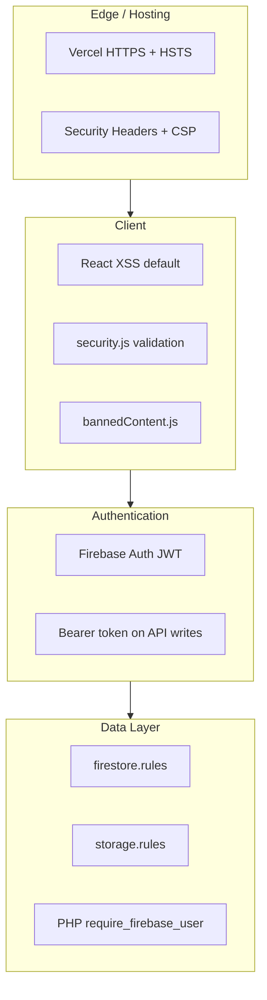

# Zarkorea — Security

> Хамгаалалтын архитектур, хэрэгжүүлсэн хяналтууд, дүрэм, зөвлөмж.
> **Эх сурвалж:** `vercel.json`, `firestore.rules`, `storage.rules`, `src/utils/security.js`, `api/bootstrap.php`

---

## Хамгаалалтын давхаргууд



---

## 1. HTTP Security Headers (Vercel)

Файл: `vercel.json` — бүх route-д (`source: /(.*)`).

| Header | Утга | Зорилго |
|--------|------|---------|
| `X-Content-Type-Options` | `nosniff` | MIME sniffing хориглох |
| `X-Frame-Options` | `DENY` | Clickjacking хориглох |
| `X-XSS-Protection` | `1; mode=block` | XSS (legacy browser) |
| `Strict-Transport-Security` | `max-age=31536000; includeSubDomains; preload` | HTTPS албадлага |
| `Referrer-Policy` | `strict-origin-when-cross-origin` | Referrer хяналт |
| `Permissions-Policy` | `geolocation=(), microphone=(), camera=()` | Browser permission хязгаар |
| `Content-Security-Policy` | (урт директив) | XSS, injection хориглох |

### CSP зөвшөөрсөн эх сурвалжууд (товч)

| Директив | Зөвшөөрөл |
|----------|-----------|
| `default-src` | `'self'` |
| `script-src` | `'self'`, `gstatic.com`, `google.com`, `apis.google.com`, `connect.facebook.net` |
| `connect-src` | `'self'`, `api.zarkorea.com`, `*.firebaseio.com`, `*.googleapis.com`, `*.firebaseapp.com`, `api.openai.com`, Facebook, `wss://*.firebaseio.com` |
| `img-src` | `'self'`, `data:`, `https:`, `blob:` |
| `frame-src` | Google, Firebase, Facebook |
| `object-src` | `'none'` |
| `form-action` | `'self'` |

CSP өөрчлөхөд `vercel.json` болон шинэ integration-ийн домэйныг нэмнэ.

---

## 2. Нууц мэдээлэл (secrets)

### Хэзээ ч commit хийхгүй

- `.env`, `api/.env`
- `mobile/google-services.json`, `mobile/GoogleService-Info.plist`
- `mobile/play-service-account.json`
- Firebase service account JSON
- OpenAI API key утгууд

### Зөвхөн нэрээр (утга биш)

| Орчин | Хувьсагчийн prefix / нэр |
|-------|---------------------------|
| Web (Vercel) | `VITE_FIREBASE_*`, `VITE_API_BASE_URL`, `VITE_OPENAI_API_KEY` |
| Mobile (EAS) | `EXPO_PUBLIC_FIREBASE_*`, `EXPO_PUBLIC_API_BASE_URL` |
| EAS file env | `GOOGLE_SERVICES_JSON`, `GOOGLE_SERVICE_INFO_PLIST` |
| PHP API | `DB_*`, `FIREBASE_WEB_API_KEY`, `OPENAI_API_KEY`, `APP_ADMIN_UIDS` |

`VITE_*` болон `EXPO_PUBLIC_*` утгууд client bundle-д орно — энэ нь Firebase web API key-ийн хувьд **хэвийн** (Firebase Console-оос хамгаалагдсан домэйн/rule-ээр).

---

## 3. Authentication

### Firebase Auth

| Онцлог | Хэрэгжилт |
|--------|-----------|
| Token удирдлага | Firebase SDK автоматаар |
| Нууц үг | Хамгийн багадаа 6 тэмдэгт (`validatePassword`) |
| Имэйл формат | `isValidEmail()` |
| Утас OTP | Синтетик имэйл → Firestore rules-тай нийцүүлэх |
| Дахин баталгаажуулалт | Бүртгэл устгахад `reauthenticateWithCredential` |

Post-login redirect (`Login.jsx`, `authService.redirectToLogin`):

- `toSafePath` — same-origin `http(s)` URL-ийг `pathname+search` болгоно; өөр origin reject
- `safeRedirectPath` — зөвхөн in-app path; `http://` / `https://` prefix reject
- Хоёулаа `/` болон `/Login*`-ийг ignore (open-redirect / loop-оос сэргийлнэ)

Файлууд: `src/services/authService.js`, `src/contexts/AuthContext.jsx`, `mobile/src/services/authService.js`.

### PHP API Bearer token

Бичих endpoint-ууд `Authorization: Bearer {Firebase ID token}` шаарддаг (`api/bootstrap.php` → `require_firebase_user()`), **except** `PATCH action=listing` when the body is only `views` incremented by one (`listingService.isViewCountOnlyBump`). That view bump is public and does not run `enforce_us_listing_row_visible`. `GET action=listing` is public; US rows outside the active region 404.

Шалгалтанд `FIREBASE_WEB_API_KEY` (серверийн `.env`) ашиглана — **client-д бүү илгээ**.

### Admin эрх

- Firestore global admin: `admin` (legacy alias) эсвэл `super_admin`
- Scoped roles: `country_admin` + `admin_country_code`; `region_admin` +
  `admin_region_code`
- PHP: MySQL `users.role` + scope баганууд; `APP_ADMIN_UIDS` нь
  super-admin override
- PHP scope lookup: `APP_ADMIN_UIDS` → `users.firebase_uid` → fallback
  `users.email` (legacy rows without Firebase UID)
- Зөвхөн super admin role/scope assign хийнэ. Хэрэглэгч өөрийн `role`,
  `isAdmin`, `admin_country_code`, `admin_region_code`-ийг өөрчилж болохгүй.
- Region admin хэрэглэгч удирдах, broadcast хийх, global config өөрчлөх
  эрхгүй.

Тохируулах ба scope matrix:
[ZARUSA_REGION_PHASES.md](./ZARUSA_REGION_PHASES.md).

---

## 4. Input validation & sanitization

Файл: `src/utils/security.js`

| Функц | Зорилго |
|-------|---------|
| `sanitizeHTML()` | HTML XSS-ээс хамгаалах |
| `sanitizeInput()` | Script tag, event handler устгах |
| `sanitizeURL()` | `javascript:`, `data:` протокол хориглох |
| `escapeHTML()` | HTML тусгай тэмдэгт escape |
| `isValidEmail()` | Имэйл формат |
| `isValidURL()` | URL формат (http/https) |
| `isValidPhone()` | Утасны формат |
| `validatePassword()` | Нууц үгийн хүч |

### Хориглосон агуулга

Хоёр тусдаа зам. `banned_content.php` нь OpenAI proxy биш.

**Түлхүүр үг** — `src/utils/bannedContent.js`, `mobile/src/utils/bannedContent.js`, `api/banned_content.php` (phrase/word жагсаалт ижил):

- Web/mobile зар илгээхийн өмнө `checkBannedListingFields`. PHP create болон view-оос өөр PATCH `api_find_banned_in_listing_payload`.
- PHP зөвхөн хадгалагддаг текст: `title`, `description`, `phone`, `kakao_id`, `wechat_id`, `whatsapp`, `facebook`, `location`, `subcategory`. `vehicle_*`, `electronics_*`, `realestate_*`, `job_*`, `contact_name` API-д унадаггүй тул server шалгалтад байхгүй.
- Чат Firestore руу шууд бичигдэнэ. `checkBannedContent` зөвхөн client.
- Таарвал HTTP 400 `{ "error": "prohibited_content", "message": "Гарчиг, тайлбар эсвэл холбоо барих талбарт зохисгүй үг агуулагдсан байна. Текстээ өөрчилнө үү." }`. `listingService` `message`-ийг харуулна.
- Зөвхөн `views` +1 PATCH энэ шалгалтыг алгасна.
- JS phrase хайлт NFKC хийнэ. PHP phrase нь `mb_strtolower` substring, word нь `/\b…\b/iu`. NFKC зөвхөн client.

**AI санал** — `checkListingWithAI` (`src/services/aiService.js`) → `POST ?action=ai_moderate`:

- Дуудагч нь `AdminNewListings` товч. Үр дүн зөвлөмж; `status` бичихгүй.
- PHP зөвхөн `systemPrompt` ба `userPrompt` авна. Body-ийн `listing` талбар хаягдана. Temperature `0.3`, `max_tokens` 500, `response_format` JSON object.
- Prompt дахь үнийн мөр үргэлж `₩`, зарын `country_code`-оос хамаарахгүй.
- Endpoint admin role шалгахгүй. Bearer token хангалттай. Хандалтыг UI хуудас хязгаарлана.

### React XSS

- Default React escaping ашиглана
- `dangerouslySetInnerHTML` зөвхөн static CSS (`chart.jsx`) дээр

---

## 5. Firestore Security Rules

Файл: `firestore.rules` (version `2`)

### Collection түвшний хураангуй

| Collection | Read | Write |
|------------|------|-------|
| `users` | Бүгд | Өөрөө / admin; `role` өөрчлөхгүй |
| `listings` | Бүгд | Auth create; owner/admin update/delete |
| `banner_ads` | Бүгд | Admin only |
| `banner_requests` | Auth | Auth create; admin update |
| `listing_reports` | Мэдэгдэгч эсвэл `isAppAdmin()` | Create: `reporter_uid` эсвэл `reporter_email`. Update/delete: дурын app admin (market scope байхгүй) |
| `feedback_messages` | `isSuperAdmin()` | Create: `user_uid` эсвэл `email`. Country/region admin уншихгүй |
| `saved_listings` | Auth | Owner create/delete (`user_uid` эсвэл `created_by`) |
| `conversations` | Participant / admin | Participant / admin |
| `messages` | Auth | Auth create; sender/receiver/admin update |
| `ai_*` | Owner (`user_email`) | Owner |
| `user_push_tokens` | Owner uid | Owner uid |
| `config` | Auth | Admin |
| `ai_usage` | `get`: байхгүй doc, token email, эсвэл super admin. `list`: auth | Create/update: `user_email` яг `token.email` |

### Тусгай логик

- **View count (legacy Firestore `listings`):** Auth хэрэглэгч зөвхөн `views` талбарыг +1 increment хийж болно (`firestore.rules`).
- **View count (MySQL listings API):** unauthenticated `PATCH` when the body is only `views` = existing + 1 (`api/index.php`). Other listing writes require Bearer.
- **Утасны хэрэглэгч:** `authEmailLower()` — token.email хоосон бол `users/{uid}.email` ашиглана.
- **Чат:** `participant_uids` эсвэл имэйлээр оролцогч шалгана.
- **Saved resolve:** `GET listing` HTTP 404 бол web/mobile хадгалалтыг Firestore-оос устгана. 404-д US region хаалт орно. Бусад алдаа мөрийг үлдээгээд зүрхийг хоосон харуулна.
- **AI квот:** `AIBot.jsx` өдөрт 20. Шалгалт client дээр. `ai_usage` бичилт token.email-тэй яг таарахгүй бол (утас OTP) хязгаар алгасаад `ai_chat` хариулна.

Deploy:

```bash
firebase deploy --only firestore:rules
```

---

## 6. Firebase Storage Rules

Файл: `storage.rules`

| Path | Read | Write |
|------|------|-------|
| `images/**`, `public/**`, `listings/**`, `banners/**` | Бүгд | Auth |
| `users/{userId}/**` | Бүгд | Зөвхөн `uid` эзэн |
| Бусад | Denied | Denied |

Deploy (`firebase.json`-д ороогүй):

```bash
firebase deploy --only storage
```

---

## 7. File upload хамгаалалт

| Хяналт | Утга / байршил |
|--------|----------------|
| Web зар / баннер формат | JPG, PNG, WEBP. Input `accept="image/*"` байсан ч `file.type` таарахгүй бол alert |
| Web зарын хэмжээ | `CreateListing.jsx` / `EditListing.jsx` локал `5 * 1024 * 1024`, WebP variant-аас өмнөх эх файл. `validateImageSize` дуудагдахгүй |
| Mobile upload | `uploadImageFromUri` 15MB-аас их бол татгалзана (`storageService.native.js`, `storageService.web.js`) |
| Баннер хэмжээ | `RequestBannerAd` / `AdminBanners` MIME шалгаад `compressImage`. `MAX_BANNER_SIZE` уншихгүй |
| Зураг багтаалт | Web listing: `createImageVariants` (WebP 3:2). Баннер: `compressImage` |
| Storage rules | Auth write. Хэмжээ, content-type шалгалт байхгүй (`storage.rules`) |

---

## 8. API аюулгүй байдал

| Онцлог | Тайлбар |
|--------|---------|
| CORS | `Access-Control-Allow-Origin: *` (`api/index.php`) — зөвхөн public read endpoint-уудад анхаар |
| Debug | `APP_DEBUG=false` production-д |
| SQL | PDO prepared statements (`api/bootstrap.php`) |
| OpenAI proxy | Key зөвхөн серверийн `OPENAI_API_KEY` |

---

## 9. Mobile нэмэлт

| Онцлог | Тайлбар |
|--------|---------|
| Push token | Зөвхөн өөрийн `user_push_tokens/{uid}` |
| Native config | `google-services.json` gitignore; EAS file env |
| Expo Go | Android push найдвартай биш — EAS build шаардлагатай |
| Account deletion | Apple 5.1.1(v) UI. Firestore adjunct + Auth user. MySQL зар, Storage файл үлдэнэ — доорх хэсэг |

---

## 9.1 Бүртгэл устгах — юу арилдаг, юу үлддэг

UI (“зар, чат устгагдана”) нь MySQL заруудыг хамрахгүй. Код: `src/services/accountDeletion.js`, `mobile/src/services/accountDeletion.js`.

**Арилна (Firestore, яг тэр имэйлээр):**

- `saved_listings` (`created_by`). Mobile нэмж `user_uid`-аар устгана. Web `user_uid` мөрийг хайнагүй.
- Legacy Firestore `listings` (`created_by` + `created_date` desc).
- `conversations` нь `participant_1` эсвэл `participant_2` тухайн имэйлтэй тэнцүү бол **бүх thread** (нөгөө талын мессеж хамт).
- `ai_conversations`, `ai_messages`, `ai_usage`.
- `users/{uid}`.
- Mobile: `unregisterCurrentPushToken`, дараа нь `user_push_tokens/{uid}/devices/*` (best-effort). Web push token хөндөхгүй.

**Үлдэнэ:**

- MySQL `listings` ба `users` (PHP API дээр account-delete action байхгүй).
- Storage зураг (`listings/…`, `banners/…`, `users/{uid}/profile/…`).
- `banner_requests`, `listing_reports`, `feedback_messages`.
- Phone email **variant** (`emailQueryVariants`). Устгалт `==` нэг имэйл; чат уншилт variant-уудыг хайдаг.

**Платформ:**

- Web `deleteAccountWithPassword`: Auth `user.email` хоосон бол `Нэвтэрсэн хэрэглэгч олдсонгүй`. Нууц үгээр `EmailAuthProvider` reauth. Phone OTP хэрэглэгчийн synthetic имэйл зөвхөн Firestore `users.email` дээр байдаг тул web устгалт түүнийг ашиглахгүй.
- Mobile `deleteAccountForCurrentUser`: password provider бол нууц үг; `isPhoneOnlyAccount` (`!user.email` + утас) бол нууц үггүй. Query имэйл нь `getResolvedAuthEmail()`.
- Хоёуланд нь Firestore цэвэрлэгээ `deleteUser`-ээс **өмнө**. `auth/requires-recent-login` гарвал өгөгдөл аль хэдийн арилсан, Auth user үлдэнэ.
- Profile баталгаажуулалт: `УСТГАХ` гэж яг бичнэ (`Profile.jsx`, `ProfileTabScreen.js`).

---

## 10. Client хязгаарлалт (abuse prevention)

`src/utils/limits.js` тогтмол болон `canCreateListing` / `canUploadImage` / `validateImageSize` / `validateBannerSize` **ямар ч модуль import хийхгүй**. PHP зар, зураг, мессеж тоолохгүй. `storage.rules` хэмжээ шалгахгүй.

| Тогтмол | Бодит хэрэгжилт |
|---------|-----------------|
| `MAX_LISTINGS_PER_USER` 50 | Шалгалт байхгүй. 51 дэх зар үүснэ. AI хязгаар биш |
| `MAX_IMAGES_PER_LISTING` 10 | Mobile `pickImage`: `assets.slice(0, 10 - images.length)`. 10 дүүрсэн үед чимээгүй буцна. Web тоолохгүй. PHP `images` JSON-ийг бүтнээр хадгална |
| `MAX_IMAGE_SIZE` 5MB | Зөвхөн web Create/Edit-ийн локал `maxSize`. Mobile upload 15MB |
| `MAX_MESSAGES_PER_CONVERSATION` 1000 | `createMessage` тоолохгүй. Web `listMessages` default **100**. Mobile `ChatScreen` **120** авна. `MESSAGE_FETCH_LIMIT` уншигдахгүй |
| `LISTINGS_PER_PAGE` 20 | Ашиглагдахгүй. Feed цонх API default 50, web Home 100 |
| `MAX_BANNERS` 10 / `MAX_BANNER_SIZE` 10MB | Ашиглагдахгүй |

Web зар зураггүй үүснэ. Mobile submit дор хаяж 1 зураг шаардана. `listing_images` хүснэгт schema-д байгаа ч `api/index.php` болон client бичдэггүй; галерей `listings.images`.

AI өдрийн хязгаар энд байхгүй. Web `AIBot.jsx` **20** асуулт, зөвхөн client. PHP `ai_chat` тоолохгүй (`docs/ARCHITECTURE.md`).

Firebase Free Tier-ийн read/write-ийг query limit, `staleTime` (3 мин) хязгаарлана. Тэр тоонууд `limits.js`-ээс уншигдахгүй.

---

## 11. Production checklist

| # | Шалгах зүйл |
|---|-------------|
| 1 | `VITE_FIREBASE_*` Vercel Production дээр тохируулагдсан |
| 2 | `firestore.rules` deploy хийгдсэн |
| 3 | `storage.rules` deploy хийгдсэн |
| 4 | `api/.env` сервер дээр, `APP_DEBUG=false` |
| 5 | Admin role зөвхөн Firebase Console-оор оноогдсон |
| 6 | `.env` файлууд git-д ороогүй |
| 7 | CSP шинэ домэйн нэмэгдсэн эсэх (шинэ integration) |

---

## 12. Мэдэгдэх аюул, зөвлөмж

| Асуудал | Зөвлөмж |
|---------|---------|
| Client-д OpenAI key | `VITE_OPENAI_API_KEY` илрүүлэгдэнэ — PHP `ai_chat` proxy ашигла |
| Public Firestore user read | `users` collection нийтэд уншигдана — хувийн мэдээлэл бүү хадгал |
| Rate limiting | Vercel default; нэмэлт хэрэгтэй бол API/Functions түвшинд |
| Dependency CVE | `npm audit`, тогтмол шинэчлэлт |
| Monitoring | Firebase Console Auth/Firestore/Functions logs |

---

## Нэмэлт эх сурвалж

- [FIREBASE.md](./FIREBASE.md) — Firebase deploy, env нэрүүд
- [FIRESTORE_SCHEMA.md](./FIRESTORE_SCHEMA.md) — collection бүтэц
- [DEPLOYMENT.md](./DEPLOYMENT.md) — production deploy
- Root `SECURITY.md` — анхны хураангуй (энэ файл илүү бүрэн)
- [OWASP Top 10](https://owasp.org/www-project-top-ten/)
- [Firebase Security Rules](https://firebase.google.com/docs/rules)
