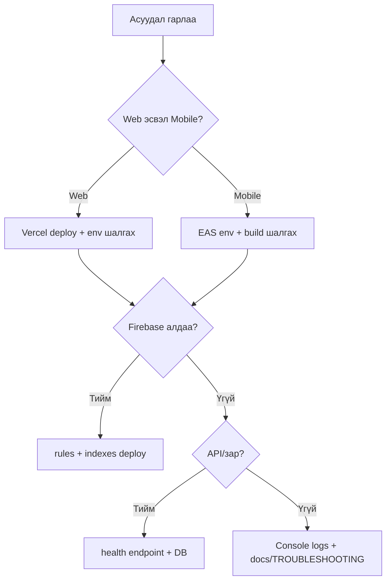

# Zarkorea — Troubleshooting

> Түгээмэл асуудал, шалтгаан, шийдэл.
> **Эх сурвалж:** кодын сан, production deploy туршлага, `project-memory/known-bugs.md`

---

## Хурдан оношилгоо

| Шинж тэмдэг | Эхлээд шалгах |
|-------------|---------------|
| Цагаан хуудас / SPA 404 | Vercel rewrite, `dist/` build |
| Firebase auth алдаа | `VITE_FIREBASE_*` / `EXPO_PUBLIC_FIREBASE_*` |
| Permission denied (Firestore) | `firestore.rules` deploy, `users/{uid}.email` |
| Index алдаа | `firebase deploy --only firestore:indexes` |
| Зар харагдахгүй | PHP API `?action=health`, `VITE_API_BASE_URL` |
| KR нүүр дээр US зар | API `append_kr_listing_read_filter` + client `filterListingsForMarket` |
| `/us` selector-д KR гарна | US config `lockCountrySelector` — US already in `ENABLED_COUNTRIES` |
| US зар detail 404 | `GET listing` + `enforce_us_listing_row_visible` (`region_code`) |
| Баннер буруу market | `banner_ads.country_code` хоосон = KR |
| Чат ажиллахгүй | Нэвтрэлт, participant email variants, indexes |
| Утасны OTP inbox хоосон | `emailQueryVariants` (KR `82` / US `1`) + `participant_uids` |
| `/CreateListing` US биш KR зар | Unprefixed write → `resolveRouteCountryCode()` = null → KR. Use `/us/CreateListing` |
| Push ирэхгүй | Functions deploy, FCM V1, Expo token |
| Mobile crash нээхэд | EAS Firebase env дутуу |

---

## 1. Web — Vercel / Build

### `vite: command not found` (Vercel build)

**Шалтгаан:** `vite` devDependency, build command буруу.

**Шийдэл:**
- `vercel.json`: `"buildCommand": "npm run build"`
- `package.json` дээр `vite` devDependencies-д байгаа эсэх
- Vercel Node version 18+

### Deploy хийсэн ч сайт шинэчлэгдэхгүй

**Шалтгаан:** GitHub холболт, буруу branch.

**Шийдэл:**
- Vercel → Project → Git → `main` branch
- Manual redeploy: Deployments → Redeploy
- `docs/archive/historical-fixes/VERCEL_GITHUB_CONNECTION_FIX.md` (түүхэн лавлагаа)

### Route refresh дээр 404

**Шалтгаан:** SPA fallback байхгүй.

**Шийдэл:** `vercel.json` rewrites:

```json
{ "source": "/((?!.*\\..*).*)", "destination": "/index.html" }
```

### PWA / manifest олдсонгүй

**Шалтгаан:** Build дээр PWA plugin ажиллаагүй.

**Шийдэл:**
- `vite.config.js` дээр `VitePWA` plugin байгаа эсэх
- Production: https://zarkorea.com/manifest.json
- `npm run build` локал дээр `dist/manifest.json` үүсэх эсэх

---

## 2. Firebase — Auth

### Нэвтрэхгүй / `auth/invalid-api-key`

**Шалтгаан:** Буруу эсвэл хоосон Firebase config.

**Шийдэл:**
- Vercel: `VITE_FIREBASE_API_KEY`, `VITE_FIREBASE_AUTH_DOMAIN`, `VITE_FIREBASE_PROJECT_ID` шалгах
- `authDomain` нь `koreazar-32e7a.firebaseapp.com` форматтай таарах (Console-той яг ижил)
- Local: `.env` үүсгэх (`.env.example` хуулах)

### Утас OTP (web) ажиллахгүй

**Шалтгаан:** reCAPTCHA, test mode.

**Шийдэл:**
- Dev: `VITE_FIREBASE_PHONE_TEST_MODE=true` + Firebase Console test дугаар
- Production web: reCAPTCHA verifier тохиргоо шалгах (`Login.jsx`)

### Утас OTP (mobile) ажиллахгүй

**Шалтгаан:** Expo Go, `google-services.json` дутуу.

**Шийдэл:**
- EAS development/production build ашиглах (Expo Go биш)
- `GOOGLE_SERVICES_JSON` EAS file env upload
- `mobile/docs/PHONE_OTP_NATIVE_SETUP.md`

### Facebook login алдаа

**Шалтгаан:** OAuth redirect, app ID.

**Шийдэл:** Root `FACEBOOK_LOGIN_SETUP.md` — Authorized domains, Facebook App тохиргоо.

### Бүртгэл устгасан ч зар / чат үлдэнэ

**Шалтгаан:** Profile delete зөвхөн Firestore adjunct + Auth user. MySQL `listings` / `users` болон Storage файл хөндөгдөхгүй. Чат query нэг имэйл (`==`); phone variant мөр үлдэнэ. Shared conversation уствал нөгөө оролцогчийн thread хамт арилна.

**Шийдэл:**

- Үлдсэн зарыг MySQL / admin listing UI-аар шалгана. Firestore `listings` index алдааг энэ шинж тэмдэгтэй бүү андуур.
- Web phone OTP: Auth `user.email` хоосон тул `deleteAccountWithPassword` шууд зогсоно. Mobile phone-only нууц үг шаардахгүй (`deleteAccountForCurrentUser`).
- `auth/requires-recent-login` гарвал Firestore аль хэдийн цэвэрлэгдсэн, Auth user үлдсэн байж болно — дахин нэвтэрч устгалтыг дуусгана.
- Дэлгэрэнгүй: `docs/SECURITY.md` §9.1

### /us-аас нэвтрээд KR нүүр (/) руу буцсан

**Шалтгаан:** `/Login` unprefixed. Redirect байхгүй бол `createPageUrl('Home')` → `/`.

**Шийдэл:**
- Home login товч: `state={{ from: location.pathname }}` (`/us` буцаана, утас `+1`)
- Guarded page: `redirectToLogin()` → `sessionStorage.loginRedirect` (full-page `/Login`)
- Шууд `/Login` нээх, эсвэл `http(s)` `?redirect=` өгөхөд Login `safeRedirectPath` хаяна — KR default
- `/` болон `/Login*` redirect-ийг хоёулаа ignore хийнэ

---

## 3. Firestore

### `Missing or insufficient permissions`

**Шалтгаан:** Rules deploy хийгдээгүй, эсвэл `users/{uid}.email` хоосон (утасны хэрэглэгч).

**Шийдэл:**

```bash
firebase deploy --only firestore:rules
```

- Дахин нэвтрэх (`ensureUserDocEmailForFirestoreRules` ажиллуулна)
- Firebase Console → `users/{uid}` → `email` талбар байгаа эсэх

### `The query requires an index`

**Шалтгаан:** Composite index байхгүй.

**Шийдэл:**

```bash
firebase deploy --only firestore:indexes
```

Эсвэл алдааны мессеж дээрх Console холбоосоор индекс үүсгэнэ.
Жагсаалт: `firestore.indexes.json`, [FIRESTORE_SCHEMA.md](./FIRESTORE_SCHEMA.md).

### Чат inbox хоосон (permission алдаагүй)

**Шалтгаан:** Participant email таарахгүй, `participant_uids` дутуу, эсвэл
KR/US утасны синтетик имэйл хувилбар зөрсөн.

**Шийдэл:**
- `resolveChatParticipantEmail()` / `resolveAuthEmail()` зөв имэйл буцааж
  байгаа эсэх (token.email OTP-д хоосон байж болно)
- `emailQueryVariants()` / `areEmailVariants()` ашиглах — raw string
  equality бүү хэрэглэ
- KR: `phone_82…@phone.zarkorea.com` ↔ national digits without `82`
- US: `phone_1` + 10 digits ↔ 10-digit national (`src/utils/emailNormalize.js`)
- Хуучин conversation-д `participant_uids` backfill:

```bash
node functions/scripts/backfill-conversation-participant-uids.js
```

`users/{uid}.email` Firestore дээр байх ёстой — `ensureUserDocEmailForFirestoreRules`.

### Inbox бүхэлдээ алга (нэг conversation буруу)

**Шалтгаан:** `participant_1` эсвэл `participant_2` string биш (`null`, тоо, объект). Web `Messages.jsx` болон Chat header `otherEmail.split('@')` дээр унана. Messages query `retry: false` тул бусад thread ч гарч ирэхгүй. Mobile `MessagesScreen.load` алдааг log хийгээд эхний нээлтэд жагсаалтыг хоосон үлдээнэ.

**Шийдэл:** Firestore дээр тухайн мөрийн хоёр participant-ийг имэйл string болго. Нэг буруу мөр бусдыг алгасна гэж бүү тооц. Дэлгэрэнгүй: [CHAT_SYSTEM.md](./CHAT_SYSTEM.md).

---

## 4. Зарууд (Listings / PHP API)

### Зар олдсонгүй / Home хоосон

**Шалтгаан:** API холболт, MySQL, буруу ID.

**Шийдэл:**

```
GET https://api.zarkorea.com/index.php?action=health
```

- `{ "ok": true, "db": "connected" }` буцах ёстой
- `VITE_API_BASE_URL` / `EXPO_PUBLIC_API_BASE_URL` зөв эсэх
- Listing ID нь **MySQL numeric** (`parseMysqlListingId`) — Firestore doc ID биш
- Home хоосон биш ч VIP/хайлт дутуу бол: API `ORDER BY created_at DESC` + limit (web 100, mobile 50, max 100). VIP эрэмбэ client дээр, цонхноос гадуурх зар орохгүй. Web search/үнэ энэ цонхон дотор. `docs/IMAGE_LOAD_ANALYSIS.md`
- Firestore `listings` индекс Home-ийг засахгүй. `docs/FIRESTORE_INDEXES.md`

### Зар үүсгэх 401 / 403

**Шалтгаан:** Bearer token дутуу эсвэл хүчингүй.

**Шийдэл:**
- Нэвтэрсэн эсэх
- PHP сервер дээр `FIREBASE_WEB_API_KEY` тохируулагдсан эсэх
- Token хугацаа дууссан бол дахин нэвтрэх

### Зургийн upload 403 (Storage)

**Шалтгаан:** Storage rules publish хийгдээгүй.

**Шийдэл:**

```bash
firebase deploy --only storage
```

`VITE_FIREBASE_STORAGE_BUCKET` / `EXPO_PUBLIC_FIREBASE_STORAGE_BUCKET` Console-ийн bucket-тай таарна.

### US ListingDetail 404 (Home-д харагдахгүй зар)

**Шалтгаан:** `GET action=listing&id=` `enforce_us_listing_row_visible` ажиллуулна. US мөрийн `region_code` хоосон, inactive, эсвэл `washington-dc` биш бол 404. KR feed isolation (`GET listings`) энэ helper-ийг дууддаггүй.

**Шийдэл:**
- ID зөв MySQL numeric эсэх
- Мөрийн `country_code` / `region_code`-ийг DB-д шалгах
- Feed-д харагдах US зар л detail-д нээгдэнэ гэж үзэх

### VIP / Онцгой зар 403

**Шалтгаан:** `enforce_listing_promotion_privileges` — `featured`/`vip` болон promo expiry-г зөвхөн scoped admin өөрчилнө.

**Шийдэл:** `/UpgradeListing` дээр энгийн хэрэглэгч зөвхөн `regular` сонгоно. Админ `AdminAllListings`-ээс confer.

### Баннер KR дээр гарч US дээр гарахгүй

**Шалтгаан:** `AdminBannerRequests` approve нь `banner_ads`-д `country_code` тавихгүй. Home `isBannerVisibleForCountry` хоосон/байхгүй утгыг KR гэж үзнэ.

**Шийдэл:**
- US/GLOBAL баннерыг `AdminBanners` дээр `country_code` тохируулж үүсгэх
- Approve-оор гарсан баннерыг засахдаа `US` эсвэл `GLOBAL` тавих
- `/RequestBannerAd` prefixгүй тул Storage folder `useActiveCountry()` (localStorage) ашиглана — listing write-ийн URL-only дүрэм биш

### “Миний баннер хүсэлт” хоосон

**Шалтгаан:** Хуудас `created_by == authEmail` шүүнэ, гэхдээ одоогийн submit payload `created_by` бичдэггүй.

**Шийдэл:** Firestore `banner_requests` document дээр `created_by` байгаа эсэхийг шалгах. Админ жагсаалт (`BannerRequest.list`) бүх хүсэлтийг авна.

---

## 5. Mobile (Expo / EAS)

### App нээхэд шууд crash

**Шалтгаан:** EAS дээр `EXPO_PUBLIC_FIREBASE_*` байхгүй.

**Шийдэл:**

```bash
cd mobile
npx eas env:push production --path .env --force
npx eas build --platform android --profile production
```

`mobile/docs/EAS_PRODUCTION_ENV.md`

### Storage bucket олдсонгүй

**Шалтгаан:** Буруу bucket нэр (`zarkorea.appspot.com` vs `koreazar-32e7a.firebasestorage.app`).

**Шийдэл:** Firebase Console → Storage → bucket нэрийг `EXPO_PUBLIC_FIREBASE_STORAGE_BUCKET`-тай яг тааруул.

### Metro `index.bundle` 500 / цагаан дэлгэц

**Шийдэл:**

```bash
cd mobile
npx expo start --clear
# эсвэл
npx expo start -c
```

### Категори вэбтэй зөрүүтэй

**Шийдэл:**

```bash
# repo root-оос
npm run sync-listings
```

Дараа нь commit + EAS rebuild.

---

## 6. Push мэдэгдэл (Chat)

### Token Firestore-д байхгүй

| Шалтгаан | Шийдэл |
|----------|--------|
| Notification permission татгалзсан | App settings → Notifications зөвшөөрөх |
| Expo Go (Android) | EAS build ашиглах |
| `google-services.json` дутуу | EAS `GOOGLE_SERVICES_JSON` |
| EAS `projectId` дутуу | `app.json` → `extra.eas.projectId` |

### Token байгаа ч push ирэхгүй (Android)

**Шалтгаан:** FCM V1 Expo дээр upload хийгдээгүй (ихэвчлэн).

**Шийдэл:**

```bash
cd mobile
npx eas credentials
# Android → production → FCM V1 → service account JSON upload
```

Дараа нь logout → login, дахин туршина.
`mobile/docs/CHAT_PUSH_SETUP.md`

### iOS OK, Android чимээгүй

Яг ижил — **FCM V1** Expo credentials дутуу. App permission л хангалтгүй.

### Cloud Function ажиллахгүй

**Шийдэл:**

```bash
firebase deploy --only functions
```

Functions Logs: Firebase Console → `onChatMessageCreatedPush`
Receiver `users` collection-д `email` таарч байгаа эсэх.

---

## 7. Admin

### Admin хуудас харагдахгүй

**Шалтгаан:** `users/{uid}.role` танигдсан admin role биш, эсвэл scoped
role-ийн талбар дутуу.

**Шийдэл:**

- Global: `role` нь `super_admin` (legacy `admin` бас дэмжинэ)
- Country: `country_admin` + `admin_country_code`
- US region: `region_admin` + `admin_country_code: "US"` +
  `admin_region_code: "washington-dc"`
- Web `AdminPanel`-ийн role assignment зөвхөн super admin-д харагдана
- PHP API parity-д MySQL `users` scope баганууд migration хийгдсэн эсэхийг
  шалгана

Дэлгэрэнгүй: [ZARUSA_REGION_PHASES.md](./ZARUSA_REGION_PHASES.md).

### Web admin UI ажиллана, PHP listing moderation 403

**Шалтгаан:** Firestore дээр role байгаа ч MySQL `users` мөр олдохгүй
эсвэл scope багана хоосон.

**Шийдэл:**

1. MySQL `users` дээр `firebase_uid` эсвэл `email` Firebase token-той таарах
   эсэхийг шалгана (`get_app_admin_scope` эхлээд UID, дараа нь email).
2. Role/scope-ийг `admin_set_user_role` эсвэл `user_sync`-аар MySQL руу
   дахин бичнэ.
3. `APP_ADMIN_UIDS` зөвхөн super-admin override — region/country admin-д
   найдах хэрэггүй.

### US admin «Нүүр» дархад KR `/` руу орно

**Шалтгаан:** Admin route prefix байхгүй; буруу home link.

**Шийдэл:** Admin page back-link `useMarketHomePath`-ийг ашиглана
(`src/hooks/useMarketHomePath.js`). Scoped US admin-д `/us` буцаана.

### `/us` дээр улс сонгогчид KR гарна

**Шалтгаан:** `ENABLED_COUNTRIES` дээр US байгаа ч `/us` lock хийгдээгүй
гэж андуурах.

**Шийдэл:** `src/config/countries/us.js` дээр `lockCountrySelector: true`.
`getSelectableCountryCodes()` энэ үед зөвхөн US буцаана. US-ийг
`ENABLED_COUNTRIES`-оос хасах хэрэггүй — тэр жагсаалт KR нүүр дээрх
нийтийн selector-д зориулагдсан.

### `/CreateListing` (prefixгүй) US биш KR зар үүсгэнэ

**Шалтгаан:** `resolveRouteCountryCode()` URL-оос л уншина. `/CreateListing`
дээр үр дүн `null` → caller KR гэж үзнэ. `localStorage`-ийн US сонголт
бичихэд нөлөөлөхгүй.

**Шийдэл:** ZAR-USA зар `/us/CreateListing` (эсвэл `/us/EditListing`) дээр
үүсгэнэ. Display-only хуудас (`/Login`, `/AIBot`) country prefixгүй.

### KR нүүр дээр US зар харагдана

**Шалтгаан:** Migration үед US мөр `country_code=KR` (эсвэл хоосон) +
`region_code` үлдсэн.

**Шийдэл:**

- API: `append_kr_listing_read_filter` (`api/regions.php`)
- Client: `filterListingsForMarket` (`src/utils/listingCountry.js`)
- Өгөгдөл засах: backup хийсний дараа
  `api/sql/fix_us_listings_country_code.sql`-ийг хянаж ажиллуулна

### Admin зар батлахад нүүр дээр харагдахгүй

**Шалтгаан:** MySQL `status` талбар, `config/app.listingAutoApprove`.

**Шийдэл:**
- API-аар зарын `status` шалгах
- `listingAutoApprove: true` бол шууд `active`
- US/KR market filter зөв `country_code` / `region_code` илгээж байгаа эсэх

---

## 8. AI Bot

### AI хариу ирэхгүй

**Шалтгаан:** OpenAI key сервер дээр байхгүй.

**Шийдэл:**
- PHP: `OPENAI_API_KEY`, `OPENAI_MODEL` (`api/.env`)
- Endpoint: `POST ?action=ai_chat` (Bearer token)
- `ai_usage` permission алдаа функцийг блоклохгүй (warning лог)

---

## 9. DNS / Domain

### zarkorea.com нээгдэхгүй

**Шийдэл:**
- Vercel → Domains → DNS records шалгах
- Cloudflare ашиглавал proxy + SSL mode
Root: `DOMAIN_SETUP_GUIDE.md`, `CLOUDFLARE_VERCEL_DNS.md`

### koreazar.vercel.app эсвэл /mn URL индексэлж байна

**Шалтгаан / хүлээлт:** `vercel.json` зөвхөн default host `koreazar.vercel.app`-ийг
`https://zarkorea.com` руу 301 хийнэ. `/mn` → `/kr`. Бусад preview host
(`*.vercel.app`) энэ жагсаалтад **байхгүй**. Canonical tag үргэлж
`https://zarkorea.com/` (`index.html`); `/us` sitemap-д ороогүй.

### API CORS алдаа

PHP `Access-Control-Allow-Origin: *` тохируулагдсан. Хэрэв алдаа гарвал:
- Request URL `VITE_API_BASE_URL`-тай таарч байгаа эсэх
- `OPTIONS` preflight амжилттай эсэх

---

## 10. Android TWA / Play Store

### Digital Asset Links баталгаажихгүй

**Шалтгаан:** `assetlinks.json` дээр placeholder fingerprint.

**Шийдэл:**
1. Bubblewrap init-ийн SHA-256 fingerprint авах
2. `public/.well-known/assetlinks.json` шинэчлэх
3. Vercel redeploy
4. https://zarkorea.com/.well-known/assetlinks.json шалгах

`docs/PLAY_STORE_SETUP.md`

---

## 11. Хуучин баримт бүү андуур

Repository root дээр 50+ markdown байна. Зарим нь **хуучирсан**:

| Хуучин | Одоогийн |
|--------|----------|
| `zar-746103b7/` path | Repo root + `mobile/` |
| `zarmongolia.com` | `zarkorea.com` |
| `carsmongolia-d410a` | `koreazar-32e7a` |
| `docs/archive/firebase-legacy/FIRESTORE_INDEXES.md` | `docs/FIRESTORE_INDEXES.md` |

Каноник лавлагаа: `docs/` хавтас (энэ файл орно).

---

## 12. Асуудал шийдэх дараалал (production)



---

## Туслах командууд

```bash
# Web локал
npm run dev

# Web build шалгах
npm run build && npm run preview

# Firestore
firebase deploy --only firestore:rules,firestore:indexes

# Functions (push)
cd functions && npm install && cd .. && firebase deploy --only functions

# Storage rules
firebase deploy --only storage

# Mobile
cd mobile && npx expo start -c

# Категори + admin role sync (web → mobile)
npm run sync-listings
npm run sync-admin-roles

# US region registry гурван копи ижил эсэх
npm run verify:zarusa-registry

# API health/scope smoke (Node; Linux/macOS OK)
npm run smoke:zarusa-api
```

Windows only (PowerShell / `curl.exe`): `deploy:zarusa-api`,
`deploy:zarusa-api:ftp`, `package:zarusa-api`. Linux/macOS дээр
`api/index.php` + `api/regions.php`-ийг гараар upload хийнэ —
[ZARUSA_STAGING_DEPLOY.md](./ZARUSA_STAGING_DEPLOY.md).

---

## Холбоотой баримтууд

| Асуудлын төрөл | Баримт |
|----------------|--------|
| Deploy | [DEPLOYMENT.md](./DEPLOYMENT.md) |
| ZAR-USA API upload | [ZARUSA_STAGING_DEPLOY.md](./ZARUSA_STAGING_DEPLOY.md) |
| Firebase | [FIREBASE.md](./FIREBASE.md) |
| Schema / index | [FIRESTORE_SCHEMA.md](./FIRESTORE_SCHEMA.md) |
| Security | [SECURITY.md](./SECURITY.md) |
| Chat / push | [CHAT_SYSTEM.md](./CHAT_SYSTEM.md) |
| Mobile env | `mobile/docs/EAS_PRODUCTION_ENV.md` |
| Push | `mobile/docs/CHAT_PUSH_SETUP.md` |

Асуудал шийдэгдэхгүй бол: Firebase Console logs, Vercel build log, Metro/EAS build log-ийг хамт шалгана.
